<div align="center">

# Accel UdyamSync

### *Ek baar mein vyapar digital* — get a small business online in one sitting

**Team Softmax** · **Airtel SYNC 2026 · YTL Hackathon · Enterprise Track A · Project Udyam Digital**

[](https://github.com/ac265640/UdyamSync/actions/workflows/ci.yml)


[**▶ Watch the demo (2 min 27 s)**](https://ac265640.github.io/UdyamSync/UdyamSync_Demo.mp4) &nbsp;·&nbsp; [**Business case (PDF)**](https://ac265640.github.io/UdyamSync/UdyamSync_Submission.pdf) &nbsp;·&nbsp; [**Architecture (PDF)**](https://ac265640.github.io/UdyamSync/UdyamSync_Architecture.pdf) &nbsp;·&nbsp; [**Privacy note (PDF)**](https://ac265640.github.io/UdyamSync/UdyamSync_Privacy_Note.pdf) &nbsp;·&nbsp; [**Deck (PPT, in browser)**](https://view.officeapps.live.com/op/view.aspx?src=https%3A%2F%2Fac265640.github.io%2FUdyamSync%2FUdyamSync_Submission.pptx) &nbsp;·&nbsp; [**Showcase page**](https://ac265640.github.io/UdyamSync/) &nbsp;·&nbsp; [**Run it**](#run-it-in-two-commands)

<a href="https://ac265640.github.io/UdyamSync/UdyamSync_Demo.mp4">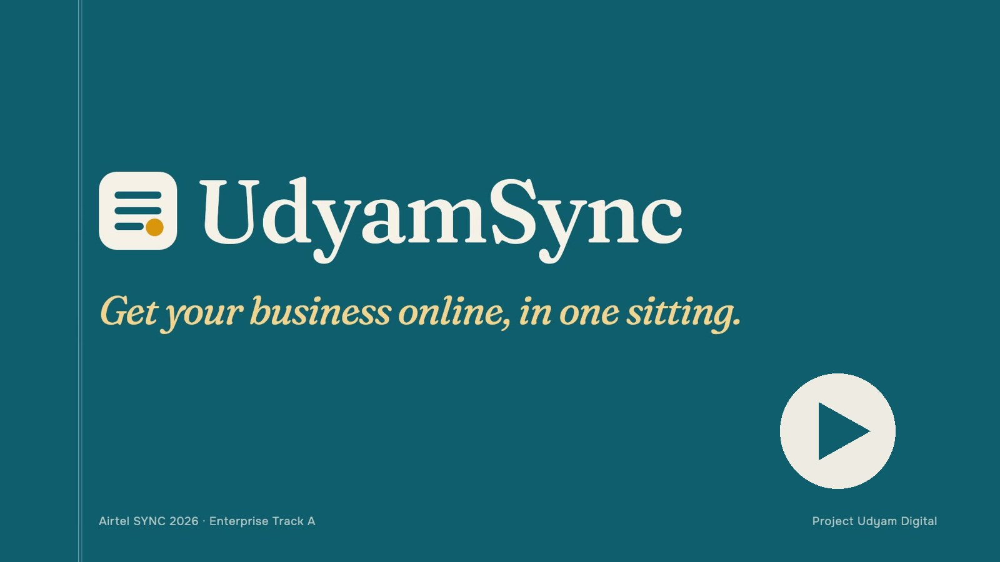</a>

<sub>Click the image to play the 2 min 27 s demo (opens in your browser).</sub>

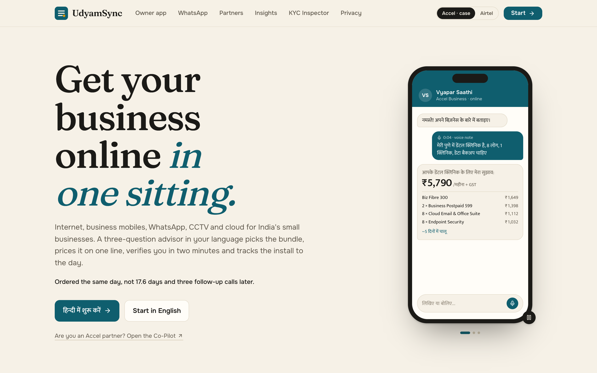

</div>

> The case uses a fictional operator, **Accel Telecom**, and its B2B arm **Accel Business**. Every business, person, identifier and figure here is synthetic. A header toggle switches the whole product to the Airtel theme.

---

## The four deliverables the case asks for

| # | Deliverable | Where |
|---|---|---|
| 1 | Working prototype: demo video (≤ 3 min) + code | [Demo video, 2:27](https://ac265640.github.io/UdyamSync/UdyamSync_Demo.mp4) · this repository |
| 2 | Solution architecture diagram | [Architecture (PDF)](https://ac265640.github.io/UdyamSync/UdyamSync_Architecture.pdf) · [image](docs/architecture.png) · [data flows](docs/ARCHITECTURE.md) |
| 3 | Business case (7 slides, as the submission form asks) | [PDF](https://ac265640.github.io/UdyamSync/UdyamSync_Submission.pdf) · [PPTX](submission/UdyamSync_Submission.pptx) |
| 4 | 1-page data privacy and security note | [Privacy note (PDF)](https://ac265640.github.io/UdyamSync/UdyamSync_Privacy_Note.pdf) · [markdown](docs/PRIVACY_NOTE.md) |

## The problem, in the case's own numbers

| 5,000 SMB leads (Apr–Jun 2026) | |
|---|---|
| Leads that become active customers | **7.36 %** (368) |
| Days from lead to live | **17.6** |
| Times a customer chases their order | **3** |
| Cost to win one customer | **₹15,053** |
| Activation with vs without a GSTIN | **9.6 % vs 2.0 %** |
| Activations sold in breach of catalogue rules | **56 of 368** |

The biggest leaks are a visit that never happens (827 leads), a quote that is too slow, too complex or too expensive (1,006), and paperwork (273). **UdyamSync removes each of these with a specific feature.**

## One sitting, four steps

| 1 · Discover | 2 · OneBill | 3 · Verify | 4 · Sign & track |
|:---:|:---:|:---:|:---:|
| 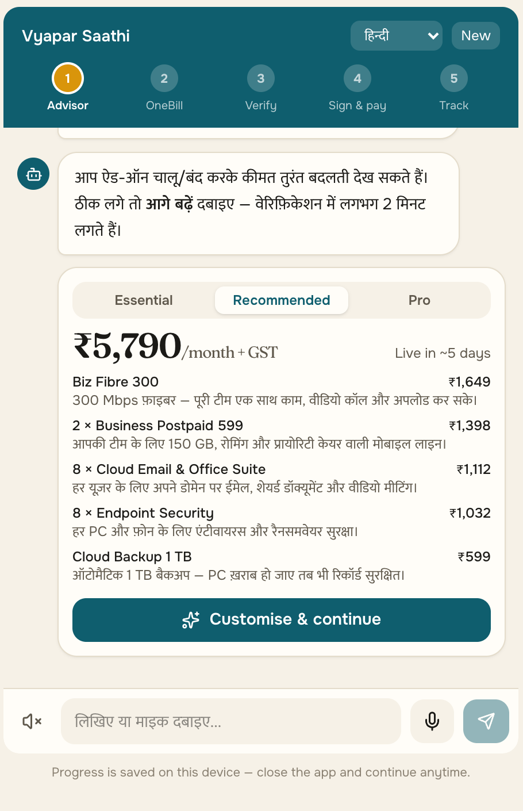 | 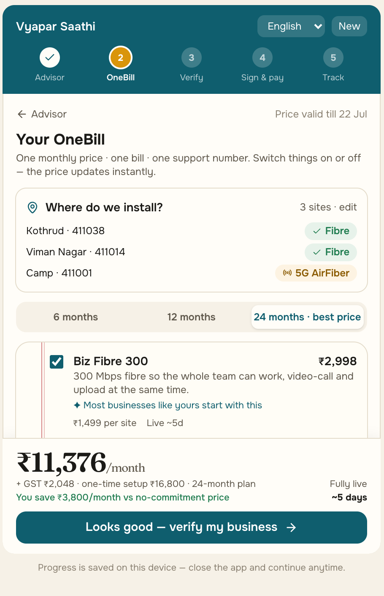 | 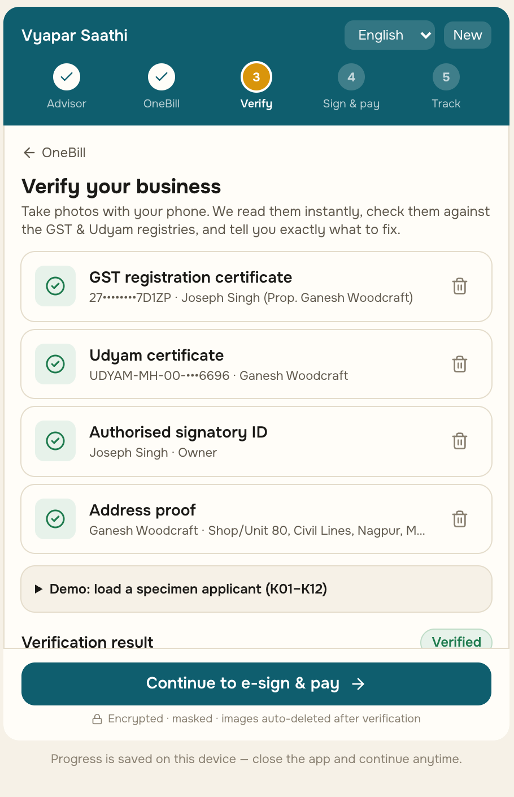 | 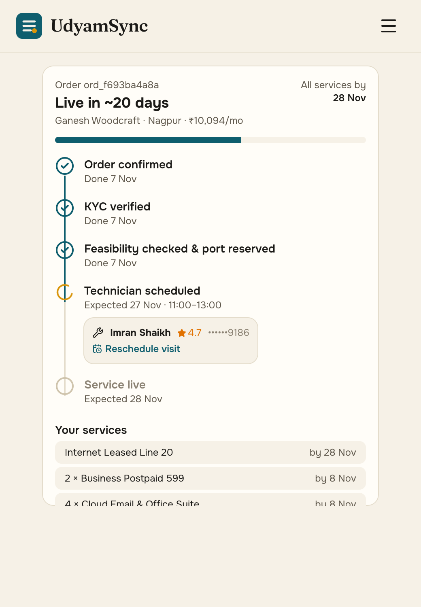 |
| Three questions by **text or voice**: Hindi, Marathi and English built in (work offline), 7 more via the optional GenAI layer. A **GSTIN fills half the answers** from the registry. | **Essential / Recommended / Pro** on one monthly line. Add-ons toggle and re-price live; each branch gets **fibre or 5G AirFiber by pincode**. | **Consent first**, then photos read **on our own server** and checked against the **GST and Udyam registries**, with a fix for every problem. | **Aadhaar e-sign** (or a link to an absent signatory), **slide-to-order UPI AutoPay**, then a five-stage tracker with WhatsApp updates. |

**Design rule: the AI talks, the rules engine decides.** Prices, eligibility and product dependencies come only from `product_catalogue.csv`. Any ₹ figure the language model writes that isn't in the structured quote is discarded. Every order is re-priced and re-checked on the server.

## Feature tour

<table>
<tr>
<td width="50%">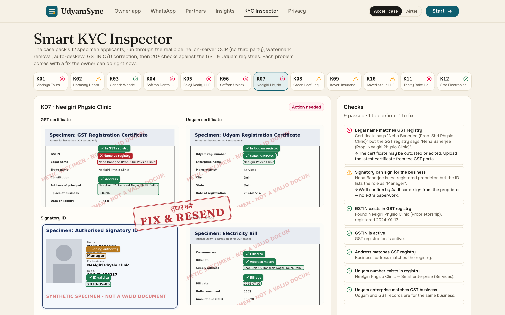</td>
<td width="50%"><b>Smart KYC Inspector.</b> All 12 specimen applicants (K01–K12) go through the real pipeline: OCR on our own server (RapidOCR/ONNX), watermark removal, auto-deskew, GSTIN O/0 correction, then 20+ registry checks. Findings are drawn exactly where the OCR read them. Every planted problem is caught: cancelled GSTIN, blank Udyam number, blurred scan, missing document, GSTIN typo (a fix is suggested from the registry), edited business name, and a 257-day-old bill.</td>
</tr>
<tr>
<td><b>WhatsApp-style chat, in Marathi.</b> The same advisor session runs inside a WhatsApp-style web chat (a simulation; production would use the WhatsApp Business API), with quick replies and voice notes. The quote card hands off to the web OneBill without repeating anything.</td>
<td>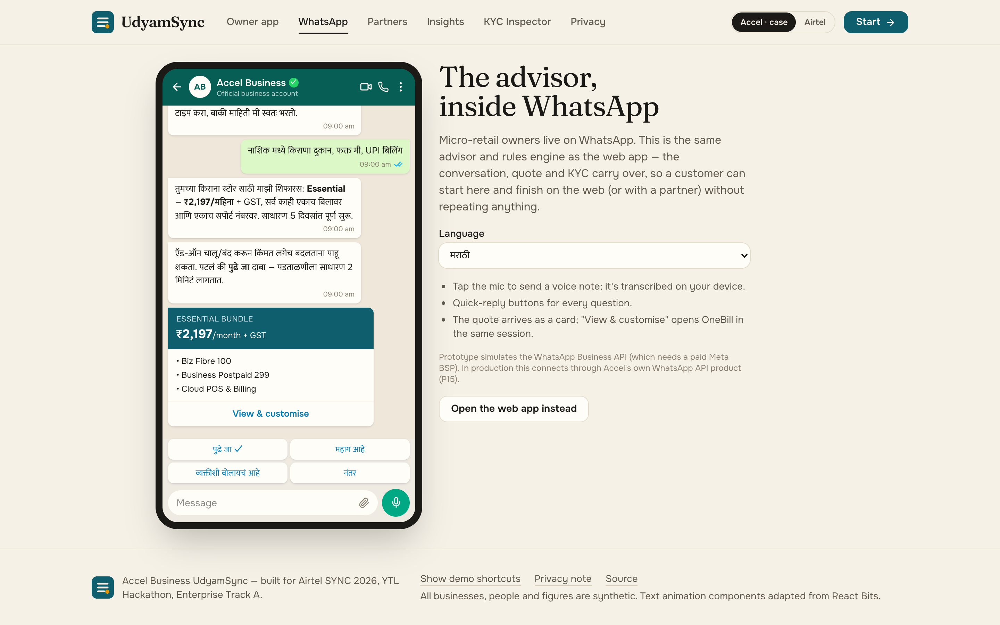</td>
</tr>
<tr>
<td>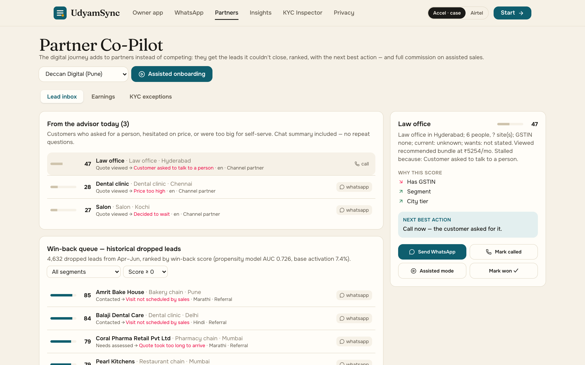</td>
<td><b>Partner Co-Pilot.</b> Leads the advisor can't close reach the local partner with the chat summary, ranked by a win-back score: logistic propensity (AUC 0.73 on held-out leads) combined with how recoverable each drop reason is. Each lead comes with a next best action. Assisted mode runs the same flow on a tablet and credits commission. KYC exceptions are fixed together with the owner.</td>
</tr>
<tr>
<td><b>Replay the Quarter.</b> The business case is computed, not claimed. The same 5,000 leads are re-run, and each drop reason is won back only by the feature that removes it, at cautious, adjustable rates. A compliance re-run blocks all 56 rule-breaking sales, and a segment matrix sets the go-to-market order.</td>
<td>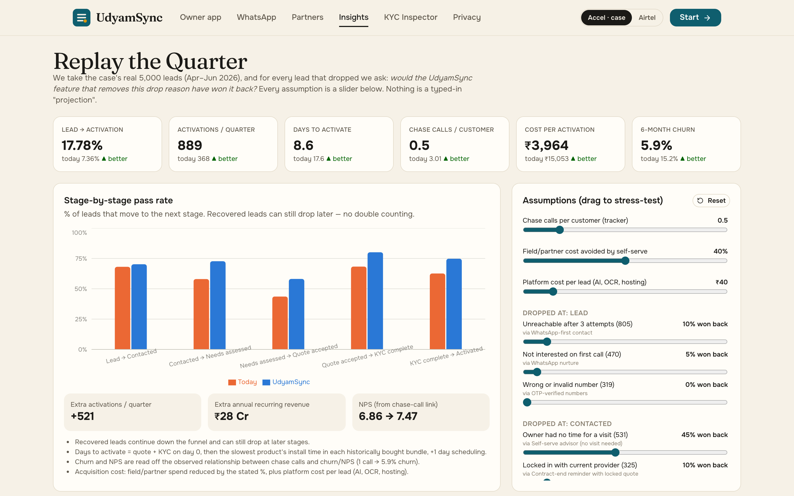</td>
</tr>
</table>

Also in the product:
- **Remote e-sign link** for an absent signatory, with a signing page on their own phone.
- **"My Data" page:** view, export, withdraw consent, erase.
- **Hash-chained consent ledger.**
- **Encrypted document vault** with a 30-day purge.
- **SLA early warning** for installs at risk of passing 21 days.
- **Saved progress** that resumes after a dropped connection.
- **Accel ↔ Airtel theme switch.**

## Impact (same 5,000 leads, replayed)

| Metric that matters | Today | Replayed | Pilot target |
|---|---|---|---|
| Lead → activation | 7.36 % | **17.8 %** | ≥ 12 % |
| Days lead → live | 17.6 | **8.6** | ≤ 12 |
| Cost per activation | ₹15,053 | **₹3,964** | ≤ ₹7,500 |
| Status chase calls / customer | 3.0 | **0.5** | ≤ 1.0 |
| 6-month churn | 15.2 % | **5.9 %** | ≤ 11 % |
| Rule-breaking sales | 56 | **0** | 0 |

That is **+521 activations a quarter** and about **₹18 crore of annual recurring revenue run-rate after one year**:
521 × 4 quarters × 94 % retained × ₹7,771 (median bundle of the segment mix actually won back, mostly micro retail) × 12.

- **Pilot targets** sit well below the replay, so the pilot is judged with a margin of safety, not against our own model.
- **Days to live:** quote, KYC and e-sign happen in one sitting, so only install time is left, and it depends on the product (AirFiber 2 days, fibre 5, leased line 21–30). The tracker shows an ETA per product.
- **Churn:** in the data, churn rises with every chase call (1 call → 5.9 %, 5 calls → 27.9 %). That is a correlation; if only half of it is causal, churn still falls to about 10.6 %.

## Architecture

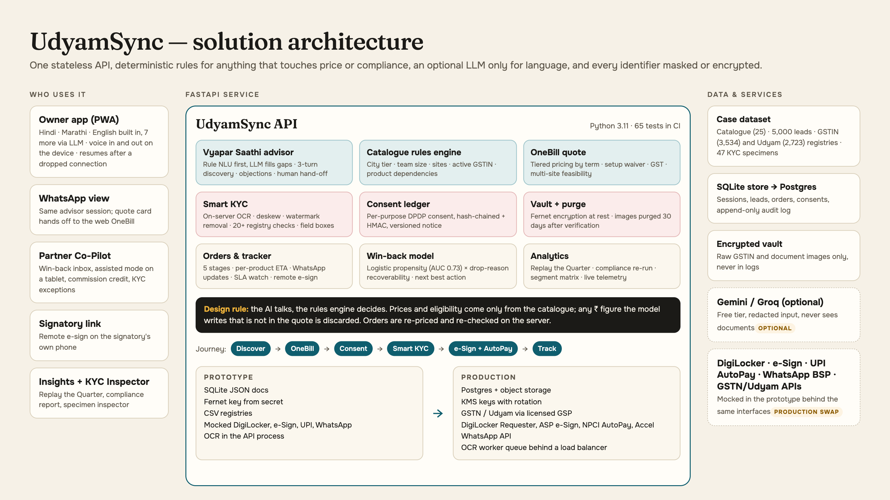

Details, data flows and the production path are in [docs/ARCHITECTURE.md](docs/ARCHITECTURE.md). The privacy and security choices are in [docs/PRIVACY_NOTE.md](docs/PRIVACY_NOTE.md).

## Run it in two commands

```bash
docker compose up --build        # then open http://localhost:8080
```

Or without Docker (Python 3.11 + Node 22):

```bash
cd backend && python3.11 -m venv .venv && .venv/bin/pip install -r requirements.txt && .venv/bin/uvicorn app.main:app --port 8000
cd frontend && npm install && npm run dev                                   # http://localhost:5173
```

- **No API key needed.** The advisor runs fully offline on rules and hand-written Hindi, Marathi and English templates.
- **Optional AI:** copy `.env.example` to `.env` and set `LLM_PROVIDER=gemini` with a free Google AI Studio key (no card) to unlock the other 7 languages and free-form questions.
- **Demo shortcuts:** open any page with `?demo=1` (or use "Show demo shortcuts" in the footer) for one-tap entry points, for example the Hindi clinic, the 3-branch restaurant, or KYC trap K05.

**Tests:** `cd backend && .venv/bin/python -m pytest -q` runs 65 tests: 30 internal advisor scenarios (the judges' scenarios will differ), all 12 KYC specimens, end-to-end orders, multi-site feasibility, remote e-sign, consent tamper detection, encryption and erasure. CI runs them on every push, together with the frontend build.

## Repository

```
backend/          FastAPI service
  app/advisor/      NLU, recommender, multilingual templates, LLM guardrails, conversation, eval scenarios
  app/kyc/          OCR pipeline, 20+ checks, consent ledger, KYC service
  app/rules.py      catalogue rules engine        app/quote.py      OneBill pricing
  app/orders.py     tracker + SLA                 app/esign.py      remote signatory link
  app/partner.py    propensity + win-back         app/analytics.py  replay, compliance, segments
  tests/            65 tests
frontend/         React + Vite + Tailwind
  src/landing/      GSAP + Lenis story (live advisor phone, pinned chapters, split-flap board)
  src/journey/      owner app: advisor, OneBill, sites, KYC, sign & pay
  src/pages/        WhatsApp, Partner Co-Pilot, Insights, KYC Inspector, Privacy, My Data, signatory page
data/             the case's synthetic dataset (catalogue, 5,000 leads, registries, 47 KYC specimens)
docs/             architecture, privacy note, design brief, blueprint, screenshots
submission/       deck (PPTX + PDF), demo video, and the scripts that build them
```

## How it was designed

The visual world comes from the merchant's **bahi-khata**, the cloth-bound ledger Indian shopkeepers already trust:

- **OneBill** is a ledger page.
- **KYC verdicts** land as a rubber stamp (*सत्यापित*).
- **Ordering** works like a UPI slide-to-pay.
- **Before → after numbers** flip like a railway split-flap board.

Type is Fraunces, Onest and Tiro Devanagari. Motion is GSAP and Lenis, used for one hero loop and two scroll moments, not decoration on every section. See [docs/DESIGN.md](docs/DESIGN.md).

The demo video is built the same way: the hook, title and closing cards are HTML scenes on paused GSAP timelines rendered frame by frame, the app scenes are Playwright recordings of the real prototype, the voiceover is the free local Kokoro voice, and FFmpeg assembles everything (see [`submission/`](submission)).

## Credits

- **Text and micro-interaction components:** adapted from [React Bits](https://reactbits.dev) (MIT + Commons Clause).
- **Motion:** [GSAP](https://gsap.com) and [Lenis](https://lenis.darkroom.engineering).
- **OCR:** [RapidOCR](https://github.com/RapidAI/RapidOCR).
- **Voice:** [Kokoro-82M](https://huggingface.co/hexgrad/Kokoro-82M).
- **Fonts:** under the SIL Open Font License.
- **Case and data:** YTL Hackathon 2026, Enterprise Track A.
