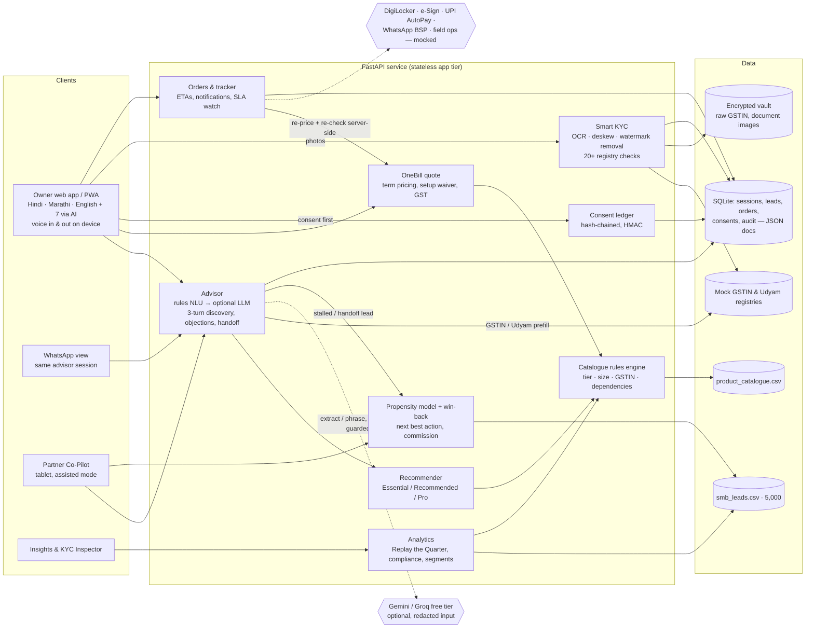

# UdyamSync — Solution architecture

## Main flows
1. **Discover:** a message (typed or spoken) goes through rule-based NLU (Hindi, Hinglish, Marathi, English). The optional LLM fills gaps and handles the 7 other languages. A GSTIN or Udyam number pre-fills the profile from the registry. The raw GSTIN goes only into the encrypted vault.
2. **Recommend:** the recommender proposes three tiers, and the rules engine enforces eligibility and dependencies against the catalogue. Prices come only from the catalogue, never from the model. Any ₹ figure the model writes is checked against the structured quote and discarded if it doesn't match.
3. **Quote:** every add-on toggle reprices server-side. Blocked products come back with reasons.
4. **KYC:** consent is required first (403 otherwise). Uploads are type- and size-checked, encrypted at rest, OCR'd on our own server (RapidOCR/ONNX, with deskew and watermark removal), then validated against the registries. The result is pass/warn/fail per check, each with a fix. Images are purged N days after verification.
5. **Order:** the order is re-priced and re-checked by the rules engine, needs KYC verified, an e-sign and a UPI AutoPay mandate. The tracker emits notifications, and an SLA watch flags installs at risk of passing 21 days.
6. **Partners:** stalled conversations become leads with a summary and a win-back score. The score combines a logistic propensity model (AUC 0.73 on held-out leads) with how recoverable the drop reason is. Assisted orders credit commission.
7. **Analytics:** "Replay the Quarter" re-runs the 5,000 historical leads with adjustable recovery rates. The compliance report re-runs the 368 historical activations through the rules engine and finds 56 that broke catalogue rules.

## Production path (what changes, what doesn't)
| Prototype | Production |
|---|---|
| SQLite JSON documents | Postgres (same document shapes) + object storage for documents |
| Fernet key from `APP_SECRET` | KMS-managed keys with rotation |
| CSV registries | GSTN / Udyam APIs through a licensed GSP |
| Mock DigiLocker, e-sign, UPI, WhatsApp | DigiLocker Requester API, ASP e-sign, NPCI AutoPay, Accel's own WhatsApp Business API |
| Single process | API behind a load balancer; OCR as a worker queue |

The rules engine, recommender, KYC checks, consent ledger and APIs stay the same.
